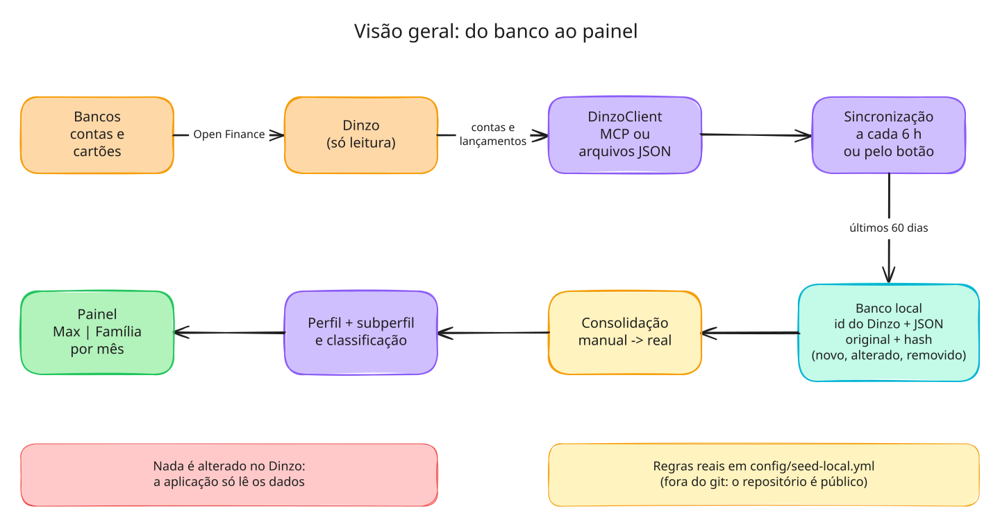
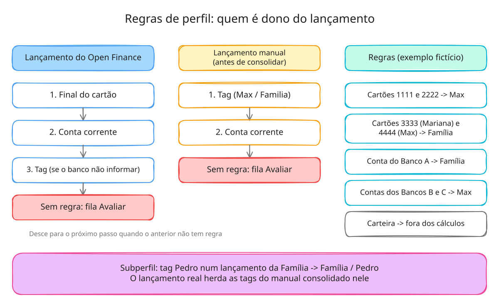
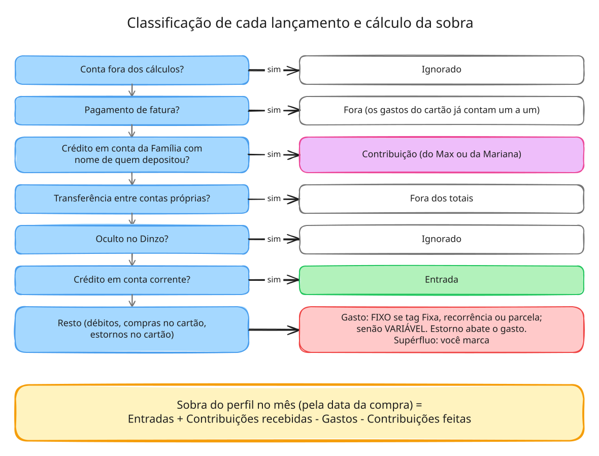
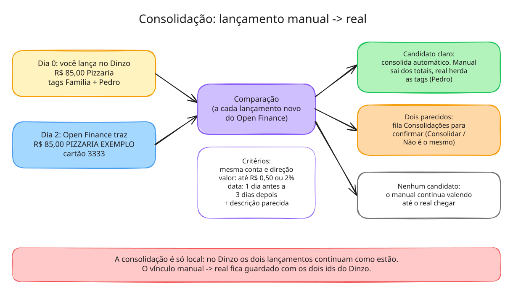

# Diagramas

O que a aplicação já faz. Os valores (finais de cartão, bancos, valores e estabelecimentos) são
**fictícios**; as regras reais ficam em `config/seed-local.yml`, fora do git.

Cada diagrama tem dois arquivos:
- `.svg`: imagem para ver no GitHub. Ela também carrega a cena embutida, então pode ser aberta
  e editada direto no [excalidraw.com](https://excalidraw.com).
- `.excalidraw`: o arquivo editável (no excalidraw.com: menu → Abrir).

## 1. Visão geral: do banco ao painel

## 2. Regras de perfil: quem é dono do lançamento

## 3. Classificação de cada lançamento e cálculo da sobra

## 4. Consolidação: lançamento manual → real

